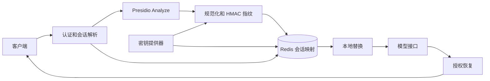

# Presidio 会话级隐私系统设计

状态：设计待评审

目标版本：首个兼容实现

## 1. 背景

当前 Presidio guardrail 在 `output_parse_pii` 开启时，为一次请求生成顺序占位符，并把占位符到原文的映射放入 `metadata["pii_tokens"]`。响应返回时，guardrail 使用同一份请求元数据恢复文本

这个实现只覆盖一次请求。下一轮再次出现同一个邮箱时会重新编号，多实例之间没有共享映射，请求元数据还可能进入日志链路。`litellm_session_id` 已经能够从请求头或请求体提取，也支持缺失会话 ID 时生成、拒绝或忽略，但目前只用于跟踪和日志聚合，没有作为隐私映射的安全边界

本设计增加一个显式启用的会话隐私模式。在同一个已认证主体和会话中，同一隐私实体获得稳定占位符。不同主体或不同会话中的相同原文不会共享占位符。原文只以认证加密后的形式存储，并在授权请求的响应阶段按需恢复

## 2. 目标

- 同一会话内重复出现的同一邮箱等实体始终得到同一占位符
- 一段输入中出现多次或多个隐私实体时，每个实体都能独立恢复
- 多个 LiteLLM 实例并发处理同一会话时得到一致结果
- 映射生命周期与会话 TTL 一致，支持滑动和固定两种过期策略
- 会话 ID 即使被猜中或泄露，也不能跨认证主体读取隐私数据
- Redis、密钥服务或密文校验失败时，在调用模型之前失败
- 保持现有非会话 Presidio 行为兼容
- 只使用 Presidio Analyze 接口，不调用 Presidio Anonymize 接口
- 支持 Chat Completions、Responses、Anthropic Messages、工具参数和流式响应现有处理面

## 3. 非目标

- 不根据文本相似度、IP 地址或请求时间推断会话
- 不把客户端提供的 `user`、邮箱或其他未认证字段单独作为数据所有权依据
- 不提供全局搜索、导出或批量解密隐私数据的管理接口
- 不在首版解决跨会话身份合并
- 不承诺经过规范化后不同写法恢复成各自原始外观。稳定占位符对应首次出现的原文
- 不替代 Presidio 的实体识别能力和准确率评估

## 4. 当前实现与缺口

| 能力 | 当前实现 | 会话模式要求 |
| --- | --- | --- |
| 会话识别 | `get_chain_id_from_headers` 和 `apply_missing_session_id_policy` | 统一得到一个经过格式校验的会话 ID，并把生成的 ID 返回客户端 |
| 隐私识别 | Presidio `/analyze` | 继续复用，并保护已经生成的占位符，避免再次识别 |
| 替换 | 请求内顺序编号 | 使用会话级稳定、不可猜测的占位符 |
| 映射存储 | 请求内 `metadata["pii_tokens"]` 明文字典 | Redis 中保存 HMAC 索引和认证密文 |
| 多实例一致性 | 无 | Redis 原子脚本分配或复用占位符 |
| 恢复授权 | 能访问请求元数据即可恢复 | 认证主体、会话和本次发送占位符三重约束 |
| 生命周期 | 单次请求 | 固定 TTL 或滑动 TTL |
| 密钥轮换 | 无会话映射 | 密文携带 `key_id`，支持保留旧解密密钥 |

## 5. 总体架构



请求阶段先完成认证和会话解析，再调用 Analyze。网关对识别结果做类型相关的规范化和 HMAC 指纹计算，通过 Redis 原子操作查找或创建稳定占位符，并在本地完成文本替换。模型响应只能恢复本次请求实际发送过、且属于同一认证主体和会话的占位符

## 6. 会话判定和所有权

### 6.1 会话 ID 来源

会话模式接受现有标准入口，优先使用 `x-litellm-session-id`，其次使用已经归一化到 `litellm_session_id` 的受支持请求字段。`x-litellm-trace-id` 继续用于跟踪，不应在会话模式中隐式覆盖显式会话 ID

首版建议将 `general_settings.missing_session_id` 配置为 `reject`。如果后续支持 `generate`，网关必须在响应头返回 `x-litellm-session-id`，客户端后续请求必须原样带回。仅在服务端生成但不返回的会话 ID 无法建立多轮语义

会话 ID 需要满足长度和字符集限制。建议 UTF-8 编码后为 8 到 128 字节，仅允许字母、数字、点、下划线和连字符。日志只记录其 HMAC 摘要

### 6.2 已认证所有者

映射的所有者来自 `UserAPIKeyAuth` 中由网关认证流程建立的字段，不信任请求体中的同名字段。所有者材料按以下优先级组成

1. `org_id`
2. `team_id`
3. 已认证 `user_id`
4. 虚拟密钥的稳定 ID 或网关保存的密钥哈希

缺失字段使用明确的类型标记，不使用空字符串拼接。系统至少需要一个不可由调用者伪造的稳定主体字段，否则拒绝启用会话恢复

```text
owner_digest = HMAC-SHA256(owner_key, encode_v1(org_id, team_id, user_id, credential_id))
session_digest = HMAC-SHA256(index_key, encode_v1(owner_digest, session_id))
```

Redis key 同时包含 `owner_digest` 和 `session_digest`。读取时仍重新计算并校验所有权，防止未来代码改变 key 规则后绕过授权

## 7. 实体身份和规范化

实体身份包含 Presidio 实体类型和规范化后的值。指纹输入使用长度前缀编码或规范序列化，不能依赖分隔符拼接

```text
fingerprint = HMAC-SHA256(index_key, encode_v1(entity_type, normalized_value))
```

使用 HMAC 可以避免攻击者从 Redis 中取得普通哈希后对常见邮箱或电话做离线字典匹配。HMAC 的标准定义和密钥要求参考 [RFC 2104](https://www.rfc-editor.org/rfc/rfc2104/)

首版规范化规则保持保守

| 类型 | 规则 |
| --- | --- |
| `EMAIL_ADDRESS` | 去除整体首尾空白，域名转小写并做 IDNA 规范化，本地部分保留大小写、点和 `+tag` |
| `PHONE_NUMBER` | 仅在区域信息足够且解析成功时转 E.164，否则只去除整体首尾空白 |
| 其他文本实体 | Unicode NFC 和整体首尾空白处理，保留大小写和内部字符 |

每种规则都带 `normalization_version`。升级规则时创建新版本，不原地改变已有指纹语义

同一规范化值如果以不同外观出现，稳定占位符恢复为首次成功写入的原文。例如 `User@example.com` 和 `User@EXAMPLE.COM` 可以共享一个实体身份，并始终恢复为首次出现的写法。这是稳定引用和逐字符往返之间的明确取舍

## 8. 占位符格式

顺序值 `<EMAIL_ADDRESS_1>` 容易猜测，模型或恶意输入可以构造一个并尝试触发恢复。会话模式使用带随机标识的格式

```text
<LITELLM_PII_EMAIL_ADDRESS_01J8Y7M3T3F0VY9K2N6Q8R4B5C>
```

标识使用 128 位以上密码学随机值并编码为固定字符集。实体类型只取 Presidio 返回值经过白名单清理后的结果。占位符在会话中稳定，在不同会话中独立生成

系统只恢复同时满足以下条件的占位符

- 属于当前认证所有者和会话
- 本次发送给模型的上下文中实际包含该占位符
- 格式和完整值精确匹配
- 对应密文通过 AES-GCM 认证校验

请求历史本身包含前几轮占位符时，这些占位符会进入本次允许恢复集合，因此完整多轮上下文仍可正常恢复

## 9. Redis 数据模型

会话使用 Redis Cluster hash tag 保证相关 key 位于同一槽位

```text
litellm:pii:v1:{owner_digest:session_digest}:meta
litellm:pii:v1:{owner_digest:session_digest}:fingerprints
litellm:pii:v1:{owner_digest:session_digest}:tokens
```

`meta` 保存 schema 版本、创建时间、最后访问时间、TTL 模式、当前映射数量和规范化版本。`fingerprints` 是 `entity_type + fingerprint` 到占位符的 Hash。`tokens` 是占位符到加密记录的 Hash

加密记录使用有版本的结构

```json
{
  "v": 1,
  "kid": "privacy-2026-01",
  "nonce": "base64url",
  "ciphertext": "base64url"
}
```

Redis 中不存储原文、会话 ID、认证主体原值或未加密的规范化值。占位符本身不是秘密，但不进入常规日志

### 9.1 原子分配

一次 Analyze 返回的实体去重后批量提交给一个短 Redis Lua 脚本。脚本为每个指纹执行查找，已存在则返回原占位符，不存在则保存新占位符和调用方预先生成的密文。脚本同时检查映射数量上限并更新所有会话 key 的 TTL

Redis 官方文档保证 Lua 脚本原子执行，因此两个实例同时第一次看到同一邮箱时只会保留一个映射，[Redis Lua scripting](https://redis.io/docs/latest/develop/programmability/eval-intro/)

应用复用当前 `RedisCache.async_register_script` 的 `EVALSHA` 和脚本重载能力。脚本不执行加密、规范化或 JSON 解析，只做有界 Hash 操作和 TTL 更新，避免阻塞 Redis

### 9.2 TTL

默认使用滑动 TTL，每次成功读取或创建映射时原子刷新所有会话 key。可配置固定 TTL，固定模式只在首次创建时设置过期时间

`ttl_seconds` 表示会话隐私映射在最后一次有效请求后的保留时间，应与产品会话有效期相同。它不是单次 HTTP 请求超时，也不是模型响应缓存时间

密钥轮换时，旧解密密钥至少保留 `最大会话 TTL + 部署安全窗口`。删除会话时一次删除同一 hash tag 下的三个 key

## 10. 加密和密钥管理

原文使用 AES-256-GCM 和每条记录独立的 96 位随机 nonce。GCM 同时提供机密性和完整性，定义参考 [NIST SP 800-38D](https://csrc.nist.gov/pubs/sp/800/38/d/final)

附加认证数据 AAD 绑定以下字段

```text
schema_version
key_id
owner_digest
session_digest
entity_type
placeholder
normalization_version
```

任何记录被复制到另一个用户、会话、实体类型或占位符下时，解密都会失败

项目已有 AES-GCM 实现，但当前通用 helper 使用单次 SHA-256 派生密钥，不接受 AAD，并默认从全局 salt key 取密钥。会话隐私不直接调用这个高层 helper。实现应抽取或增加一个小型强类型 AES-GCM 原语，显式接收 32 字节数据密钥、nonce 和 AAD，不改变现有密文兼容逻辑

系统使用三个相互独立的密钥用途

| 用途 | 配置名 | 作用 |
| --- | --- | --- |
| 所有者摘要 | `owner_key` | 隐藏认证主体组合 |
| 实体索引 | `index_key` | 生成实体和会话 HMAC |
| 数据加密 | `encryption_keys[kid]` | AES-256-GCM 加密原文 |

密钥从现有 secret manager 解析，不允许直接出现在管理 API 响应、日志或序列化后的 guardrail 配置中。配置指定一个活动 `key_id` 和多个只用于解密的旧 key。新记录只使用活动 key，读取旧记录时按 `kid` 选择 key。未知 `kid`、认证失败或格式错误都按安全失败处理，不回退返回密文或原文

首版不做读取时自动重加密。旧记录最多保留一个会话 TTL，避免在响应路径引入额外写入和竞态

## 11. 请求处理流程

### 11.1 输入阶段

1. 完成正常认证并建立 `UserAPIKeyAuth`
2. 解析并验证会话 ID，计算所有者和会话摘要
3. 从所有受支持 API 形态提取文本片段，复用现有共享 prompt 转换能力
4. 识别已有合法占位符并把它们加入本次允许恢复集合，不把占位符再次发给 Presidio
5. 对剩余文本调用 Presidio Analyze
6. 校验区间、置信度、实体类型和重叠关系
7. 规范化实体并计算 HMAC 指纹
8. 加密首次出现实体的原文候选值
9. 通过 Redis 原子脚本批量解析或创建映射
10. 按区间倒序在本地替换文本
11. 把本次实际发送的占位符集合放入不可序列化的请求上下文
12. 调用模型

会话模式不会调用 Presidio Anonymize。这样可以稳定控制占位符格式，也减少一次网络往返，并避免大输入在 Anonymize 阶段重复传输

### 11.2 输出阶段

输出处理使用请求上下文中的允许集合批量读取 Redis 记录，验证所有权和 AAD 后解密。非流式响应在完整内容上做精确替换。流式响应使用有界缓冲区处理跨 chunk 占位符，缓冲长度为最大占位符长度减一

如果同时配置输出 PII 检测，先对模型新生成的普通文本执行 Analyze 和会话映射，再恢复允许集合中的占位符。新生成的 PII 默认脱敏后返回，不立即恢复，否则输出检测失去意义

明文映射不写入 `metadata`、日志、追踪属性、错误消息或 spend log。请求结束后释放内存中的解密值

## 12. 配置设计

在 `PresidioConfigModel` 中增加一个嵌套配置，避免继续增加平铺开关

```yaml
guardrails:
  - guardrail_name: presidio-session
    litellm_params:
      guardrail: presidio
      mode: pre_call
      presidio_analyzer_api_base: http://presidio-analyzer:3000
      session_privacy:
        enabled: true
        ttl_seconds: 86400
        ttl_mode: sliding
        max_entities_per_session: 10000
        max_entity_bytes: 4096
        active_key_id: privacy-2026-01
        owner_key_secret: os.environ/PRESIDIO_OWNER_KEY
        index_key_secret: os.environ/PRESIDIO_INDEX_KEY
        encryption_key_secrets:
          privacy-2026-01: os.environ/PRESIDIO_ENCRYPTION_KEY_2026_01
```

建议的类型约束如下

```text
enabled: bool = false
ttl_seconds: int, 60 到 2592000
ttl_mode: "sliding" | "fixed" = "sliding"
max_entities_per_session: int, 1 到 100000
max_entity_bytes: int, 1 到 65536
active_key_id: 非空字符串
owner_key_secret: SecretStr 引用
index_key_secret: SecretStr 引用
encryption_key_secrets: key_id 到 SecretStr 引用的只读映射
```

启用时启动校验必须确认 Redis 可用、活动 key 存在、三类密钥不是同一个值、数据密钥解码后恰好为 32 字节，并且 Presidio guardrail 运行在输入阶段。首版只支持 `fail_closed`，不提供容易误配的降级开关

`output_parse_pii` 在会话模式下视为开启。配置同时显式设置为 `false` 时启动失败，避免管理员以为响应不会恢复

## 13. 错误处理

| 场景 | 外部行为 | 是否调用模型 |
| --- | --- | --- |
| 缺少或非法会话 ID | 400 | 否 |
| 无可信认证主体 | 403 | 否 |
| Presidio Analyze 失败 | 沿用现有安全失败错误 | 否 |
| Redis 不可用或脚本失败 | 503 | 否 |
| 会话实体数量超限 | 429 | 否 |
| 单实体过大 | 413 | 否 |
| 密钥不存在或密文认证失败 | 503，并记录不含 PII 的安全事件 | 已调用时停止响应恢复 |
| 占位符不在本次允许集合 | 原样保留 | 已调用 |
| 会话已过期 | 输入中的旧占位符原样保留，新 PII 建立新映射 | 视请求内容而定 |

会话过期后无法恢复旧占位符是预期行为。客户端保留的上下文寿命不能超过会话映射 TTL，否则需要重新发送原始内容或开始新会话

## 14. 安全边界和威胁处理

| 威胁 | 处理方式 |
| --- | --- |
| 猜测会话 ID | 所有 Redis key 和读取都绑定认证主体 |
| Redis 数据泄露 | 原文为 AES-GCM 密文，索引为 HMAC，key 中没有原始身份 |
| 常见邮箱字典攻击 | 使用独立秘密 `index_key` 的 HMAC，不使用普通 SHA-256 |
| 占位符枚举 | 使用 128 位以上随机标识，不使用纯顺序编号 |
| 把密文复制到另一会话 | AAD 绑定所有者、会话、类型和占位符 |
| 并发首次写入 | Redis 原子脚本保证单一映射 |
| 恶意模型构造占位符 | 只恢复本次发送上下文中实际存在的完整占位符 |
| 日志泄露 | 明文不进入 metadata、日志、指标和追踪 |
| 密钥轮换中断恢复 | 密文携带 `kid`，旧 key 保留到最长 TTL 之后 |
| Redis 淘汰部分 key | 三个 key 每次原子刷新 TTL，任何结构不完整都安全失败 |

Redis 必须启用传输加密、认证、持久化和禁止不受控的 eviction。生产环境不接受仅进程内缓存，因为多实例和重启后会失去映射一致性

## 15. 性能和容量

主要成本仍是 Presidio Analyze。HMAC、AES-GCM 和文本替换为本地线性操作，Redis 每次请求使用一次批量原子脚本和一次批量读取，网络往返保持常数级

为避免长上下文每轮重复分析全部历史，后续可以增加安全的片段分析缓存，但不纳入首版。缓存需要绑定内容 HMAC、Presidio 配置版本、语言、实体配置和 analyzer 版本，否则可能复用过期识别结果

首版需要采集以下不含 PII 的指标

- Analyze 时延和输入字节数
- Redis 映射时延
- 本次新建、复用和恢复的实体数量，按实体类型聚合
- 会话映射数量和超限次数
- Redis、密钥和认证失败次数
- 输入、模型和输出阶段总时延

指标和日志禁止记录会话 ID、实体指纹、占位符、密文和原文

## 16. 代码组织

建议新增一个聚焦模块 `litellm/proxy/guardrails/guardrail_hooks/presidio_session_privacy.py`，包含强类型配置解析后的领域类型、规范化器、密码原语封装、Redis repository 和 session service。Redis Lua 源码与 repository 放在同一模块，避免为单个功能拆出过多文件

现有文件改动范围

| 文件 | 改动 |
| --- | --- |
| `litellm/types/guardrails.py` | 增加 `PresidioSessionPrivacyConfig` 和配置校验 |
| `litellm/proxy/guardrails/guardrail_initializers.py` | 解析 secret 引用，注入 Redis、密钥提供器和 session service |
| `litellm/proxy/guardrails/guardrail_hooks/presidio.py` | 在现有 Analyze 结果和响应恢复点接入 session service |
| `litellm/proxy/litellm_pre_call_utils.py` | 收紧会话模式下的会话 ID 来源，生成模式时标记响应头 |
| 对应响应中间件 | 返回生成的 `x-litellm-session-id` |
| OpenAPI 和 UI guardrail schema | 暴露非敏感配置字段，密钥只接受 secret 引用 |

不要让 `presidio.py` 直接操作 Redis 或密钥。它只负责 API 形态的文本提取、Presidio 调用和调用 session service

## 17. 测试方案

### 17.1 单元测试

- 同一会话重复邮箱得到同一占位符，不同邮箱得到不同占位符
- 同一邮箱在不同会话和不同所有者下得到不同占位符
- 邮箱域名大小写规范化符合规则，本地部分、点和 `+tag` 不被错误合并
- 多个邮箱和同一邮箱的多次出现都能正确恢复
- 两个并发调用首次看到同一实体时只产生一个映射
- 修改密文、AAD、实体类型、占位符或会话后解密失败
- 活动 key 加密，旧 `kid` 仍可解密，未知 `kid` 失败
- 固定 TTL 不刷新，滑动 TTL 在成功访问时刷新
- 达到实体数量和实体大小上限时不产生部分写入
- 未发送给模型的占位符即使属于该会话也不会恢复
- Presidio、Redis和密钥失败时不会调用模型
- 请求元数据、日志捕获和指标中不出现测试原文

### 17.2 集成测试

使用真实 Redis 和本地 Presidio 容器运行，不调用真实模型接口。模型适配层返回输入占位符，验证完整前后处理链路

覆盖 Chat Completions、Responses、Anthropic Messages、工具调用参数、同步流式和异步流式。多实例测试启动两个独立 guardrail 实例，共享 Redis，交替发送同一会话的多轮请求

### 17.3 端到端验收场景

```text
会话 S，用户 A，第 1 轮：联系 alice@example.com 和 bob@example.com
模型看到：联系 <token-a> 和 <token-b>
用户看到：联系 alice@example.com 和 bob@example.com

会话 S，用户 A，第 2 轮历史中再次出现 alice@example.com
模型再次看到相同 <token-a>
用户仍看到 alice@example.com

会话 S，用户 B，输入 alice@example.com
模型看到不同于用户 A 的占位符
```

验收还要验证 Redis 中搜索不到原始邮箱，删除或等待 TTL 后无法再恢复旧占位符

### 17.4 性能门槛

在现有 Analyze 基准文本上增加 10K、100K、500K 和小于 1M token 的会话测试。每档至少预热 1 次并测量 5 次，报告中位数、P95、峰值 RSS、Presidio 时间、Redis 时间和网关本地处理时间

同一输入第二轮的 Redis 映射阶段不应随已有实体总数线性扫描。Lua 脚本耗时应只与本次唯一实体数量相关。性能测试不调用模型接口

## 18. 交付阶段

### 阶段一：核心能力

实现配置模型、密码原语、Redis repository、会话 service 和完整单元测试。功能默认关闭，不改变现有用户行为

### 阶段二：Presidio 接入

接入输入替换、非流式恢复、所有受支持 API 形态和错误处理，使用真实 Redis 与 Presidio 完成集成测试

### 阶段三：流式和运维

接入流式恢复、生成会话 ID 的响应头、指标、会话删除内部接口和性能报告

### 阶段四：灰度上线

先对单一内部路由启用，观察 Redis 容量、Analyze 时延、失败率和日志泄露检查。确认旧模式未受影响后按 guardrail 配置逐步扩大范围

## 19. 完成标准

实现只有在以下条件全部满足时才算完成

- 功能默认关闭，现有 Presidio 测试全部通过
- 同一认证主体和会话中的实体跨轮、跨实例稳定
- 不同主体或会话不能互相恢复
- Redis 中没有隐私明文或可离线猜测的普通哈希
- 所有解密都验证 AES-GCM 标签和完整 AAD
- Redis、密钥或 Presidio 故障不会继续调用模型
- 非流式和流式 API 的功能测试通过
- 日志、追踪、错误响应和 spend log 泄露测试通过
- 小于 1M token 的 Analyze 和会话映射性能报告完成
- 配置文档包含密钥生成、轮换、TTL、Redis 和客户端会话 ID 示例

## 20. 待评审决定

实现前只剩三个需要产品或运维确认的参数，不影响架构

1. 默认会话 TTL，建议 24 小时
2. 单会话最大实体数，建议 10000
3. 缺失会话 ID 时仅拒绝，还是允许生成并通过响应头返回。安全和实现最简单的首版建议仅拒绝
